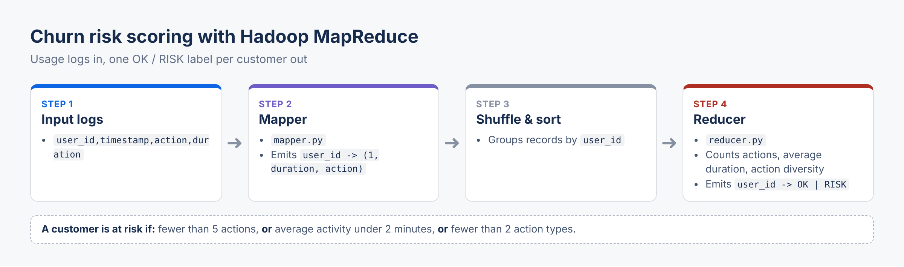

# 🎯 Détection de Clients à Risque de Churn avec Hadoop MapReduce

> 🇬🇧 **English summary:** Detects customers at risk of churn with Hadoop MapReduce jobs written in Python, with use cases in telecom, banking and SaaS.



## 📋 Problématique Métier

Dans les secteurs des télécommunications, de la banque et du SaaS, identifier les clients susceptibles de partir (churn) est crucial pour la rétention. Ce projet analyse des logs d'usage massifs pour détecter automatiquement les clients à faible engagement, indicateur clé du risque de churn.

### 🎯 Objectifs

- **Scalabilité** : Traiter des téraoctets de logs d'usage quotidiens
- **Automatisation** : Scoring automatique des clients selon leur niveau de risque
- **Actionnable** : Résultats directement exploitables par les équipes marketing/customer success

## 🏗️ Architecture

### Format des Données d'Entrée

```csv
user_id,timestamp,action,duration
U123,2025-09-01 10:10:10,login,0
U123,2025-09-01 10:15:00,watch_video,300
U124,2025-09-01 11:00:00,login,0
U124,2025-09-01 11:05:00,watch_video,20
```

### Critères de Détection de Risque

Un client est considéré **à risque** si au moins un de ces critères est vérifié :

- ⚠️ **Moins de 5 actions** sur la période analysée
- ⏱️ **Durée moyenne d'activité < 2 minutes**
- 🎭 **Diversité d'actions < 2 types** (ex: seulement login/logout)

### Pipeline MapReduce

#### 🗺️ **Mapper** (`mapper.py`)

- Lit chaque ligne de log
- Extrait : `user_id → (1, duration, action)`
- Émet les données structurées pour l'agrégation

#### 📊 **Reducer** (`reducer.py`)

- Agrège par `user_id`
- Calcule :
  - Nombre total d'actions
  - Temps total et temps moyen d'activité
  - Diversité des actions (nombre de types différents)
- Applique les règles métier
- Émet : `user_id → OK|RISK`

## 📁 Structure du Projet

```

hadoop-churn-detection/
│
├── mapper_reducer/
│   ├── mapper.py              # Mapper Python pour extraction des données
│   └── reducer.py             # Reducer Python pour agrégation et scoring
│
├── data/
│   ├── generate_test_data.py  # Générateur de données de test réalistes
│   ├── sample_input.txt       # Données d'exemple générées
│   └── user_profiles_reference.txt  # Profils de référence pour validation
│
├── scripts/
│   ├── run_hadoop.sh          # Script d'exécution Hadoop Streaming
│   └── run_local_test.py      # Test local sans Hadoop
│
├── README.md                  # Cette documentation
├── .gitignore                # Fichiers à ignorer par Git
├── local_test_results.txt    # Résultats du test en local
└── Requirements.txt

```

## 🚀 Installation et Utilisation

### Prérequis

- **Hadoop** configuré avec HDFS
- **Python 3.6+**
- Variables d'environnement : `HADOOP_HOME`

### 1️⃣ Génération des Données de Test

```bash
cd data/
python3 generate_test_data.py
```

Cela génère :

- `sample_input.txt` : 700+ lignes de logs simulés
- `user_profiles_reference.txt` : Profils de référence pour validation

### 2️⃣ Test Local (Sans Hadoop)

```bash
cd scripts/
python3 run_local_test.py
```

**Avantages du test local :**

- ✅ Validation rapide de la logique
- 🐛 Debug facile des scripts
- 📊 Comparaison avec les profils de référence

### 3️⃣ Exécution sur Hadoop

#### Préparation des données

```bash
# Créer les répertoires HDFS
hdfs dfs -mkdir -p /user/input/churn_data
hdfs dfs -mkdir -p /user/output

# Copier les données
hdfs dfs -put data/sample_input.txt /user/input/churn_data/
```

#### Lancement du job

```bash
cd scripts/
chmod +x run_hadoop.sh
./run_hadoop.sh /user/input/churn_data /user/output/churn_results
```

#### Récupération des résultats

```bash
# Voir un aperçu
hdfs dfs -cat /user/output/churn_results/part-00000 | head -20

# Télécharger tous les résultats
hdfs dfs -get /user/output/churn_results ./results
```

## 📊 Exemple de Résultats

```
U001    OK
U002    RISK
U003    OK
U004    RISK
U005    OK
```

### Statistiques Typiques

- **Clients analysés** : 50
- **Clients à risque** : 10 (20%)
- **Clients OK** : 40 (80%)

## 🔧 Configuration Avancée

### Personnalisation des Seuils

Modifiez les constantes dans `reducer.py` :

```python
MIN_ACTIONS = 5          # Minimum d'actions
MIN_AVG_DURATION = 2     # Durée moyenne minimale (minutes)
MIN_ACTION_DIVERSITY = 2 # Types d'actions minimum
```

### Profils d'Utilisateurs Simulés

Le générateur crée 3 profils réalistes :

| Profil             | % Users | Actions/jour | Durée moy. | Diversité |
| ------------------ | ------- | ------------ | ----------- | ---------- |
| **Active**   | 30%     | 8-15         | 30-600s     | Élevée   |
| **Moderate** | 50%     | 3-8          | 10-300s     | Moyenne    |
| **At Risk**  | 20%     | 1-3          | 5-60s       | Faible     |

## 🎯 Cas d'Usage Métier

### 1. **Télécommunications**

- Analyser les logs d'appels, SMS, data
- Identifier les clients réduisant leur usage

### 2. **Banque/Finance**

- Logs de transactions, connexions app mobile
- Détecter la baisse d'engagement

### 3. **SaaS/Streaming**

- Logs de connexions, visionnages, interactions
- Prédire les résiliations

## 🚀 Extensions Possibles

## 🛣️ Roadmap

- ✅ Version MapReduce fonctionnelle (MVP)
- ✅ Générateur de données réalistes
- 🔲 Intégration PySpark
- 🔲 Pipeline temps réel (Kafka + Spark)
- 🔲 Déploiement Dockerisé

### 📈 **Scoring Avancé**

- Remplacer les règles simples par du machine learning
- Intégrer des features temporelles (tendances)

### ⚡ **Migration PySpark**

```python
# Exemple de logique équivalente en PySpark
df.groupBy("user_id").agg(
    count("action").alias("total_actions"),
    avg("duration").alias("avg_duration"),
    countDistinct("action").alias("action_diversity")
).withColumn("risk_status", 
    when((col("total_actions") < 5) | 
         (col("avg_duration") < 120) | 
         (col("action_diversity") < 2), "RISK")
    .otherwise("OK")
)
```

### 🔄 **Pipeline Temps Réel**

- Intégration avec Kafka/Kinesis
- Streaming avec Spark Structured Streaming

## 🐛 Dépannage

### Erreurs Communes

**1. `HADOOP_HOME not set`**

```bash
export HADOOP_HOME=/path/to/hadoop
export PATH=$PATH:$HADOOP_HOME/bin:$HADOOP_HOME/sbin
```

**2. `Permission denied` sur les scripts**

```bash
chmod +x mapper_reducer/*.py
chmod +x scripts/*.sh
```

**3. `JAR Hadoop Streaming non trouvé`**

```bash
find $HADOOP_HOME -name "hadoop-streaming*.jar"
```

### Logs de Debug

```bash
# Voir les logs du job
yarn logs -applicationId <application_id>

# Logs HDFS
hdfs dfs -cat /user/output/churn_results/_logs/history/*
```

## 📚 Ressources

- [Documentation Hadoop Streaming](https://hadoop.apache.org/docs/current/hadoop-streaming/HadoopStreaming.html)
- [Guide MapReduce](https://hadoop.apache.org/docs/current/hadoop-mapreduce-client/hadoop-mapreduce-client-core/MapReduceTutorial.html)
- [Bonnes pratiques Python pour Hadoop](https://www.cloudera.com/tutorials/getting-started-with-hadoop-tutorial.html)

---

**💡 Ce projet démontre comment transformer un problème métier complexe en solution scalable avec Hadoop MapReduce, applicable à des téraoctets de données en production.**
